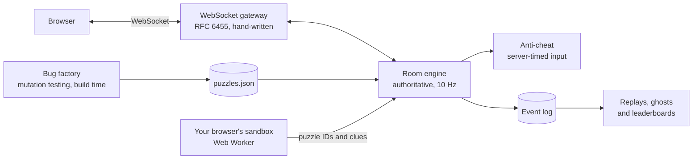

# HOTFIX!

A live multiplayer coding game, drawn like a comic book. A villain called The Regression keeps breaking production. Find the bug, fix it, and out-type your friends.

- **Hunt** rounds show a function and a failing test. Tap the broken line, then pick the fix that makes the test pass (or press 1 to 4).
- **Race** rounds are a typing race on real code. Enter jumps to the next line and skips the indent. On phones a row of code keys saves digging for symbols.

Pick a speed first. **Chill** gives 90-second rounds, the easiest bugs, shorter races, slower bots, and hints. **Normal** gives 60-second rounds, and **Hardcore** 40 seconds with the nastiest bugs. Phones start on Chill.

Play solo against bots, take the daily challenge (the same puzzles for everyone that day, always on Normal so the leaderboard is fair), or share a 4-letter code and play with friends. Anyone with the code can also watch a game live. Every finished game gets a replay link, and **Make your own** turns your own function and tests into a game.

## How it's built

One Node.js 22 process, written in TypeScript, with **zero dependencies**.



- **The server is the referee.** Clients send inputs; the server owns the clock and decides every score. A player only sees fix options after finding the broken line, and the real fix is mixed in with other bugs the factory proved fail the tests.
- **A bug factory makes the puzzles.** It plants every one-token bug it can in each function, runs the function's tests in a sandbox, and keeps only bugs that change behaviour. Across 44 functions it tried 295 bugs, threw out 18 that changed nothing, and kept 277 puzzles.
- **Player code never runs on the server.** Fixes are compared token by token. Custom games are tested in a Web Worker in the creator's own browser, and the server re-plants every bug from the source text before trusting any of it.
- **Anti-cheat runs on server time.** Pastes, superhuman typing and guessing every fix are caught or slowed down.
- **Every input is logged.** Finished games replay move by move from the log, and the best run on each snippet races again as a ghost.

The live version of this diagram, with real numbers and the latest load test, is at `/web/architecture.html`. The reasoning behind each choice is in [docs/adr](docs/adr).

The functions in the corpus were written for this game, each with its own tests. All the artwork is hand-made SVG in `web/art`. The bots in solo mode are labelled as bots.

## Run it

Needs Node.js 22.13 or newer. No install step.

```bash
npm start
```

Open http://localhost:5320.

```bash
npm test
```

```bash
npm run puzzles
```

`npm run puzzles` rebuilds `server/puzzles.json` after you change `server/corpus.ts`.

```bash
npm run load -- http://localhost:5320 200 60
```

`npm run load` plays 200 simulated players in rooms of four for 60 seconds against any running copy of the game and saves the results to `web/load-test.json`, which the architecture page shows. On a laptop: 2,034 messages a second, 5 ms replies at p95, 15% of one CPU core, 100 MB, no errors.

## Layout

| Path | What it does |
| --- | --- |
| `server/corpus.ts` | The functions and their tests |
| `shared/factory.ts` | Tokenizer and mutation engine, shared by the server and the browser |
| `server/puzzles.ts` | Builds the puzzle bank by running each mutant's tests |
| `server/ws.ts` | WebSocket server |
| `server/rooms.ts` | Rooms, rounds, scoring, bots, anti-cheat, spectators, event log and replays |
| `server/index.ts` | HTTP and WebSocket entry point |
| `web/` | The game, the replay page and the architecture page |
| `web/sandbox.ts` | The only code allowed to evaluate a player's function, in a Web Worker |
| `web/art/` | Hand-drawn SVG artwork |
| `scripts/` | Puzzle builder and load test |
| `docs/adr/` | Architecture decision records |

## Licence

MIT
